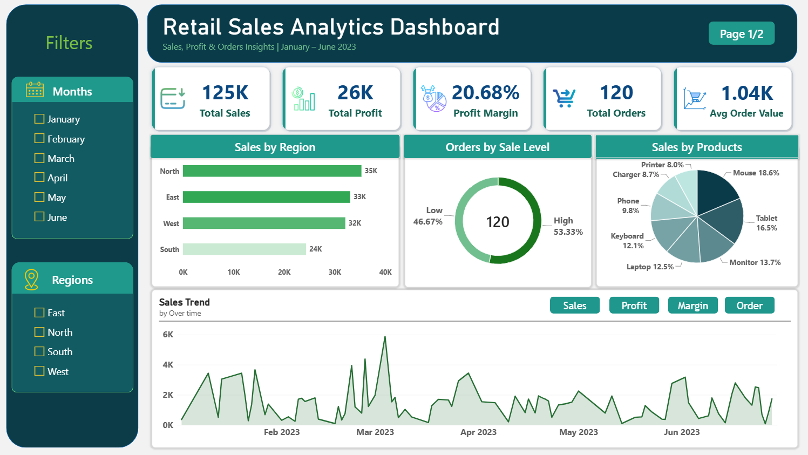
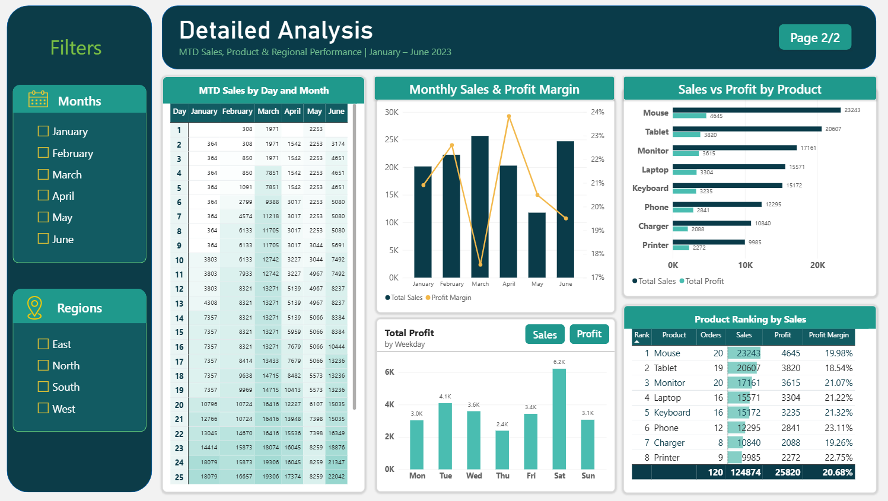

# Retail Sales Analytics Dashboard (Power BI)

Interactive 2-page Power BI dashboard analysing retail sales, profit and
orders for January–June 2023.

## Dashboard Preview
### Page 1 – Overview

### Page 2 – Detailed Analysis

## Key Metrics
- Total Sales: 124,874 | Total Profit: 25,820
- Profit Margin: 20.68% | Total Orders: 120 | Avg Order Value: 1.04K

## Key Insights
- North is the top region by sales (35K); South is the lowest (24K).
- Mouse is the best-selling product (23,243 in sales, 18.6% share).
- Saturday generates the highest profit (6.2K).
- Profit margin peaked in April (~24%) and dropped in March (~17.5%).
- Phone has the highest margin (23.11%), Tablet the lowest (18.54%).

## Features
- Month and Region slicers
- KPI cards, bar, donut, pie, line and combo charts
- Month-to-date (MTD) sales matrix by day and month
- Product ranking table with orders, sales, profit and margin
- Metric toggle (Sales / Profit / Margin / Order) using bookmarks

## Tools
Power BI Desktop, DAX, Power Query

## Files
- `Retail_Sales_Dashboard.pbix` – Power BI file (open with Power BI Desktop)
- `data/` – dataset used
